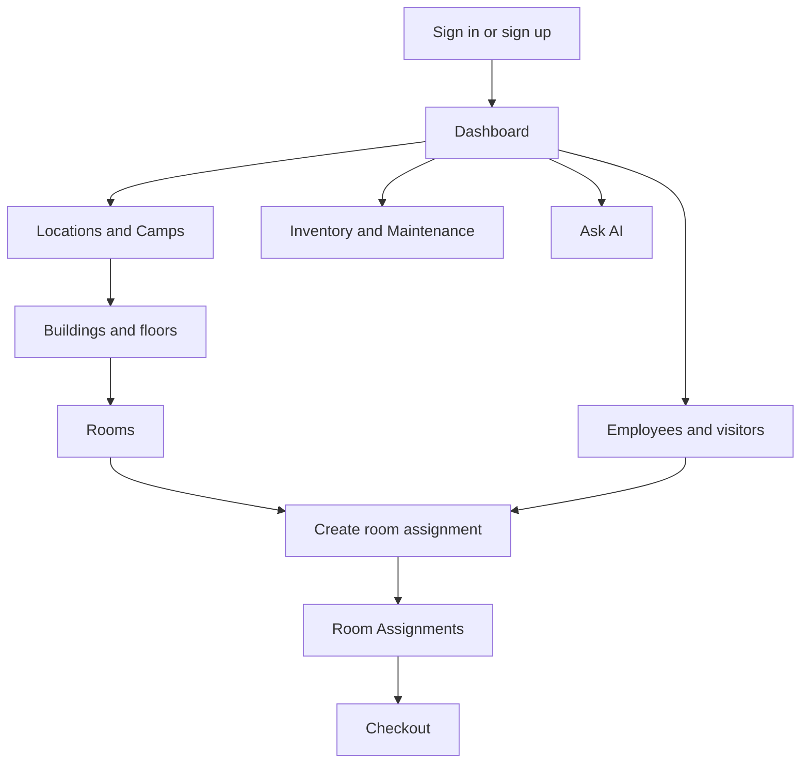
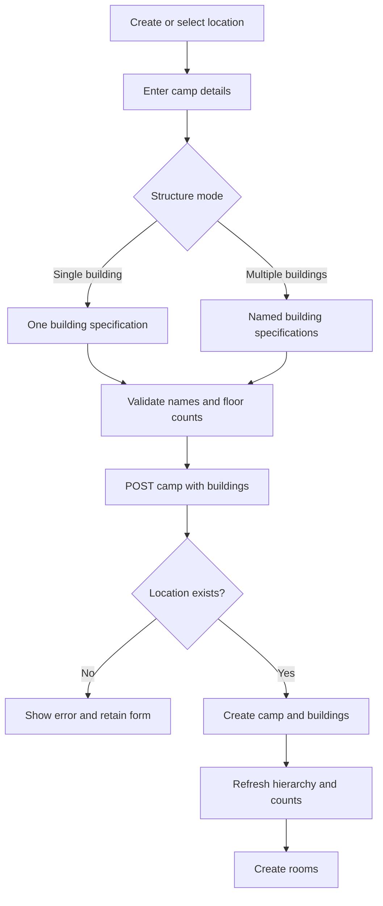
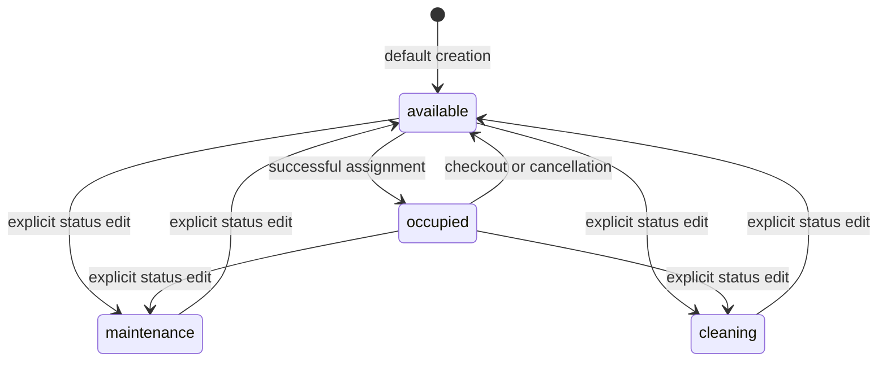
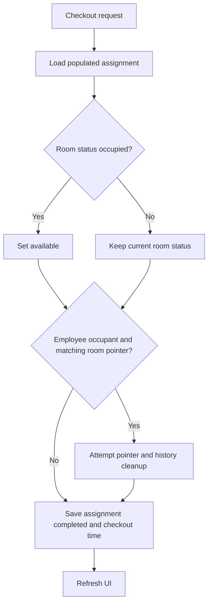
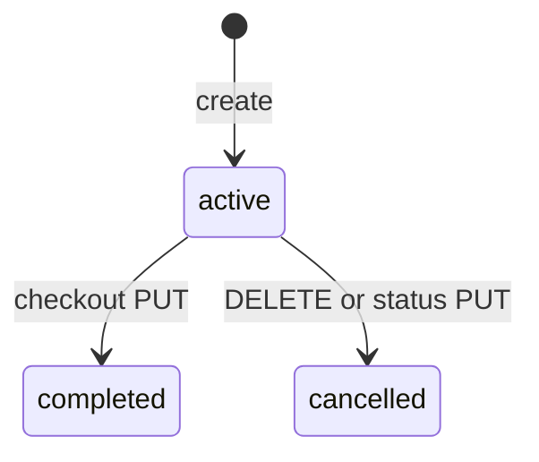
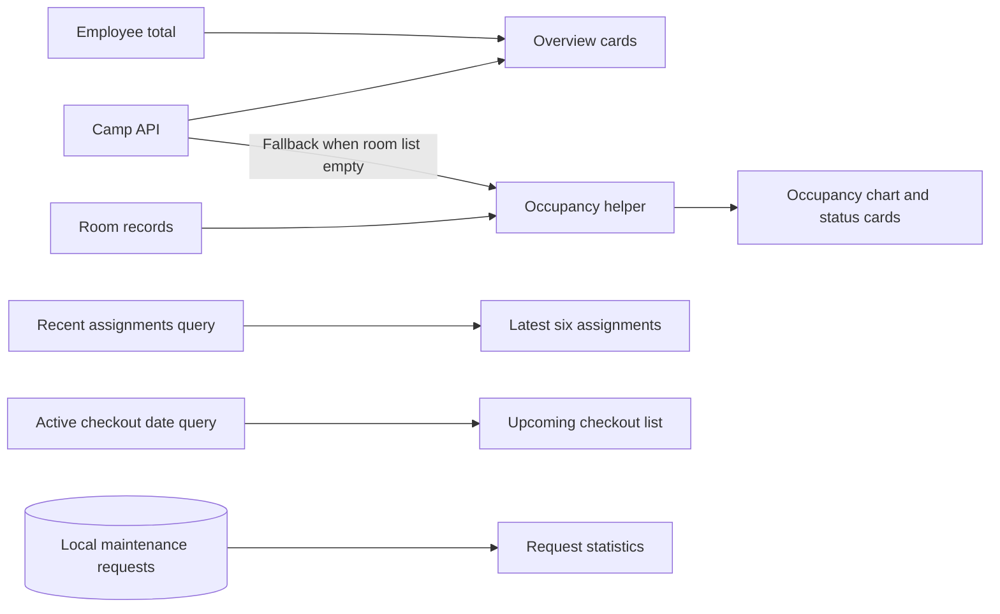
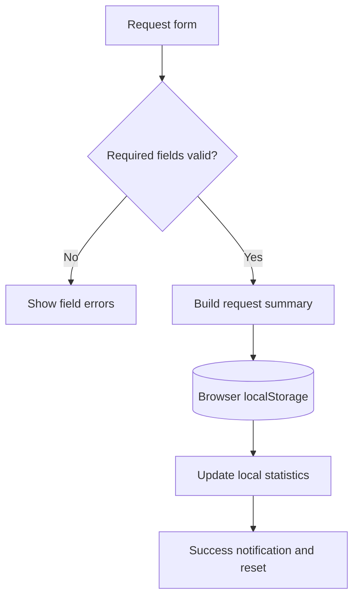
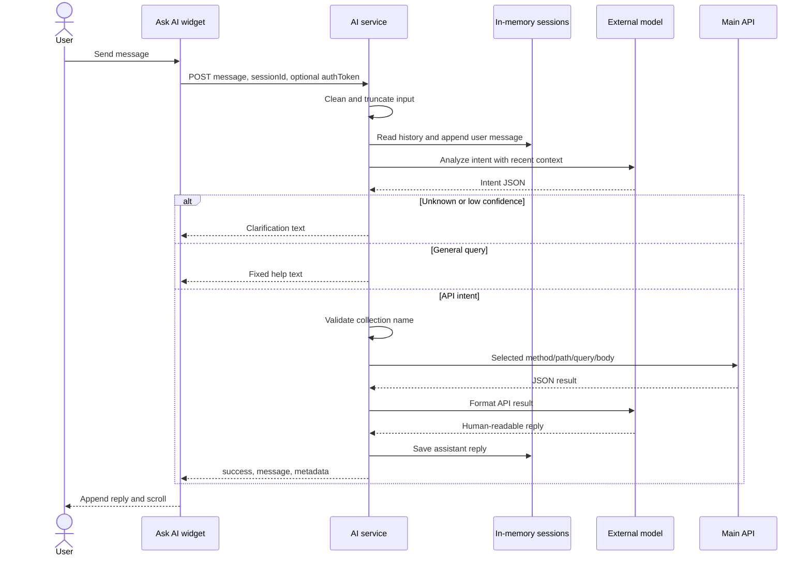
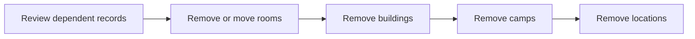

# CampWise application and system flows

**Reviewed:** 11 October 2026 · **Baseline:** `c8c7514` · [Documentation index](README.md)

These flows describe current UI and API behavior. Notes marked **Gap** identify behavior that is incomplete, inconsistent, or only enforced by the UI. They should not be read as implemented future requirements.

## 1. Actors and navigation

| Actor / component | Role |
| --- | --- |
| Application user | Logs in and manages accommodation through the UI |
| Employee / visitor | Occupant represented by an Employee record; not necessarily a login account |
| Browser | Validates forms, manages screen state, sends HTTP requests, stores local maintenance summaries |
| Main API | Validates dedicated domain operations and writes MongoDB records |
| AI service | Maps text to API requests and formats results |

The backend declares user/admin roles, but current routes do not enforce role separation. “Administrator” below describes the operational actor, not a guaranteed access restriction.



### Dashboard shortcuts

| Action | Destination / effect |
| --- | --- |
| Assign Room | `/rooms?action=assign`; opens assignment for first available loaded room |
| Add Employee | `/employees?action=add` |
| Add Visitor | `/employees?action=add&type=visitor` |
| Locations & Camps | `/locations-camps` |
| Add Camp | `/locations-camps?action=add-camp` |
| Maintenance | `/inventory-maintenance?tab=repair` |

RoomAssignments also handles `/room-assignments?action=assign&roomId=<id>`. Its available room options combine room status with active assignments in the loaded assignment data; the backend independently checks the target room.

## 2. Sign-in, registration, and sign-out

**Entry:** `/sign-in` or redirect from a protected page. **Input:** account name and password. **Outcome:** persisted frontend session and navigation to the requested pathname or `/home`.

```mermaid
sequenceDiagram
    actor User
    participant UI as Sign-in form / useAuth
    participant API as Main API
    participant DB as Users collection
    participant Store as Redux / localStorage
    User->>UI: Enter name and password
    UI->>API: POST /api/sign-in {user,password}
    API->>DB: Find user by name
    DB-->>API: User and password hash
    API->>API: Compare password; sign 24-hour JWT
    alt Valid credentials
        API-->>UI: token and user
        UI->>Store: Set signedIn, token, user authority
        UI->>UI: Navigate to redirectUrl or /home
    else Invalid credentials
        API-->>UI: 400 error
        UI-->>User: Display sign-in error
    end
```

Registration maps the form's `user` value to backend `name`, checks email existence, saves the hashed password, issues a token, and signs the user in. Every registration is assigned admin by the current endpoint.

Sign-out calls the frontend sign-out service and then clears Redux auth/user state even if the call fails. The backend has no corresponding sign-out route. Existing JWTs are not revoked. The browser route guard tests stored token presence and signedIn rather than validating expiry.

**Gaps:** backend business routes do not mount JWT middleware; login names are not unique-indexed; password recovery/reset screens have no implemented backend flow; bearer token sources differ across clients.

Sources: [useAuth](../src/utils/hooks/useAuth.ts), [ProtectedRoute](../src/components/route/ProtectedRoute.tsx), [server](../server/server.js), [User](../server/models/User.js).

## 3. Initial location, camp, and building setup

**Entry:** Locations & Camps. **Precondition:** a location must exist before a camp; a building must exist before rooms. **Outcome:** a navigable accommodation hierarchy with live counts.

1. Create a location with a name; optionally enter city/address. The server rejects a duplicate name at create time and saves active status by default.
2. Select the location and choose Add Camp. Enter camp name, description, optional price, and building structure.
3. Choose the form's single-building or multiple-building arrangement. Shared structure helpers generate building specifications. A single-building camp still creates a Building record.
4. The UI validates structure and submits camp plus inline buildings.
5. Backend checks the location, camp name, building names, duplicate names in the request, and integer floors.
6. Backend attempts camp/building creation in a transaction. Unsupported transactions invoke sequential fallback.
7. On success, UI refreshes camps, buildings, and locations, selects the parent location, and closes the form.
8. Buildings can be added later to an existing camp. Floors range from 1 to the building's declared count.



**Failure rules:** location name/camp name/building uniqueness errors are surfaced; invalid floor count blocks creation. The API accepts no buildings, even though the primary UI requires a usable structure. Transactional creation is coordinated, but standalone fallback only deletes the camp on failure and can leave partial buildings.

**Editing:** moving a camp validates its new location and updates the legacy label. Renaming a location updates child Camp.location strings. Reducing building floors is rejected if any room sits above the requested maximum. Dedicated building PATCH does not move a building to another camp.

Sources: [LocationsCamps](../src/views/admin/LocationsCamps/LocationsCamps.tsx), [CampStructureFields](../src/components/admin-dashboard/CampStructureFields.jsx), [camp routes](../server/routes/camps.js), [building routes](../server/routes/buildings.js).

## 4. Room creation, generation, and status editing

### Single room

**Entry:** Rooms → add room. Select hierarchy placement, floor, number, type, capacity, price, amenities/status as offered by the form. The API requires a building and derives its camp; a client-provided camp cannot override placement through this route.

```mermaid
sequenceDiagram
    actor Operator
    participant UI as Room form
    participant API as Room route
    participant DB as MongoDB
    Operator->>UI: Select building and enter room details
    UI->>API: POST /api/rooms
    API->>DB: Load building
    API->>API: Validate floor; derive camp
    API->>DB: Save room with compound unique index
    alt Valid and unique
        DB-->>API: Saved room
        API-->>UI: 201 populated room
        UI-->>Operator: Refresh list and confirm
    else Invalid placement or duplicate
        API-->>UI: 400, 404, or 409 message
        UI-->>Operator: Correct input
    end
```

Room numbers are unique per building, not per camp and not per floor. A move to another building/floor repeats placement checks. `capacity` is descriptive; assignment still reserves the entire room.

### Bulk room generator

1. Pick a building and supply one or more floor specifications.
2. For each specification, enter floor, starting number, count, type, capacity, and optional price/amenities.
3. The UI submits those specifications to `POST /api/rooms/bulk`.
4. Backend checks count 1–500 per specification, positive integer capacity, type, floor bounds, and a numeric suffix on the starting number.
5. Expand sequences: `A-01`, count 3 → `A-01`, `A-02`, `A-03`.
6. Reject duplicate generated numbers or existing numbers before insertion.
7. Insert rooms as available; return created count/records; refresh UI.

**Gap:** despite “all-or-nothing” comments, no database transaction wraps insertMany. Ordinary preflight conflicts insert nothing, but concurrent/database errors can cause partial writes. Inspect actual rooms before retrying a failed batch.

### Room states



This shows common operations, not an enforced transition graph. PATCH accepts any valid status enum. Checkout releases only occupied rooms, preserving maintenance/cleaning. Manual status edits do not reconcile assignments. Submitting a maintenance request does not change room status.

Sources: [RoomManagement](../src/views/admin/RoomManagement/RoomManagement.tsx), [RoomGeneratorForm](../src/components/admin-dashboard/RoomGeneratorForm.jsx), [room routes](../server/routes/rooms.js).

## 5. Employee and visitor lifecycle

**Entry:** Employees, Add Employee shortcut, or Add Visitor shortcut. **Outcome:** an Employee record, optionally with a camp/room reference and embedded room history.

1. Select employee type Permanent, Temporary, or Visitor.
2. Enter first/last name, email, phone, iqama number, and employee ID. The UI validates required values and email format.
3. Optionally supply project, department, designation, free-text location, camp, and current room.
4. Backend verifies unique email/iqama/employee ID and existing camp/room when provided.
5. Save profile; if a current room was supplied, append initial embedded history.
6. List/detail views use populated camp/current-room fields. Edits refresh data and history.

| Action | Record changes | Changes not performed |
| --- | --- | --- |
| Create with currentRoomId | Employee pointer and embedded history | No RoomAssignment or room occupancy update |
| Change current room | Close prior open history if matched; append new; update pointer | No assignment reconciliation |
| Clear current room | Clear pointer; close matching embedded history | No room release/checkout |
| Deactivate | status Inactive | Does not clear room or complete assignment |
| End Visit | PATCH Inactive and currentRoomId null | Does not cancel/complete assignment or free room |

**Gap:** profile-room editing and assignment management are independent write paths. For an operational checkout, use Room Assignments and verify all related data instead of assuming profile changes perform it.

Visitors remain Employee records. The assignment UI maps Visitor selection to occupantType Temporary Visitor, which the backend treats differently from Employee. Consequently visitors lack the automatic history/currentRoomId synchronization in the assignment creation path.

Sources: [EmployeeManagement](../src/views/admin/EmployeeManagement/EmployeeManagement.tsx), [employee routes](../server/routes/employees.js).

## 6. Room assignment and check-in

**Entries:** Rooms → assign a selected room; Dashboard → Assign Room; Room Assignments → new assignment. **Inputs:** room, occupant type/occupant, start date, expected checkout date.

**UI validation:** occupant and both dates required; Room Assignments also requires room; expected checkout must be after start. Employee options exclude Visitor records; visitor options select those records. Lists are based on loaded employee data, not an unbounded server search.

```mermaid
sequenceDiagram
    actor Operator
    participant UI as Assignment form
    participant API as Assignment route
    participant DB as MongoDB
    Operator->>UI: Choose room, occupant, and dates
    UI->>UI: Validate required fields and date order
    UI->>API: POST /api/assignments
    API->>DB: Load room and check active assignment
    alt Room unavailable or already assigned
        API-->>UI: 400; no new assignment
    else Room available
        opt Occupant type Employee
            API->>DB: Find employee
            API->>DB: Save currentRoomId
            API->>DB: Append and save embedded history
        end
        API->>DB: Save active assignment, checkInTime now
        API->>DB: Set room occupied
        API-->>UI: 201 populated assignment
        UI->>UI: Refresh assignments / rooms
        UI-->>Operator: Show success
    end
```

Backend checks required fields, room existence, available status, absence of another active room assignment, and employee existence for Employee occupants. It does not allocate individual beds. A future start date still occupies the room immediately.

**Rooms-page variation:** after assignment succeeds, RoomManagement sends another room PATCH to occupied, then reloads rooms. If that extra request fails, the UI can report failure after the assignment was already saved.

**Gaps and recovery implications:**

- Writes are sequential, without rollback. An employee pointer/history can change before assignment saving fails, or assignment can save before room updating fails.
- There is no active-assignment unique index, so simultaneous requests can pass the pre-check.
- Existing assignments for the same occupant are not rejected; employee currentRoomId can be overwritten.
- Employee active status, camp consistency, and date ordering are not validated by the create handler.
- Temporary Visitor skips employee lookup, pointer updates, and history, although the UI chooses a visitor Employee ID.
- On an uncertain result, inspect assignment, room, and employee data before retrying.

Sources: [RoomAssignments](../src/views/admin/RoomAssignments/RoomAssignments.tsx), [RoomManagement](../src/views/admin/RoomManagement/RoomManagement.tsx), [assignments.js](../server/routes/assignments.js).

## 7. Checkout and cancellation

**Entry:** active assignment in Room Assignments. **Normal outcome:** completed assignment with checkout time; occupied room becomes available; matching employee room/history is intended to close.

1. Operator chooses checkout and confirms the UI prompt.
2. Client sends PUT `{status:"completed",checkOutTime:<current ISO time>}`.
3. Backend loads the assignment with populated room/camp.
4. If room status is occupied, change to available. Preserve maintenance/cleaning status.
5. For Employee, attempt to clear currentRoomId only if it matches and close the first open matching history item.
6. Save assignment; populate response; UI refreshes assignments and rooms and closes selected detail if appropriate.



DELETE `/api/assignments/:id` is cancellation, not physical deletion. It sets cancelled and checkout time now, with similar room/employee effects. This exists in the API regardless of whether a particular screen exposes a cancel button.



This diagram shows the intended lifecycle; the route does not enforce allowed transitions. PUT can set active without reoccupying a room. Repeating completion/cancellation can release an occupied room without checking whether it belongs to a newer active assignment.

**Gap:** the employee cleanup comparison calls toString on a populated assignment room document rather than consistently extracting `_id`. Cleanup may be skipped. Multi-document writes are also nontransactional. Verify the employee pointer and embedded history independently of the assignment status.

## 8. Dashboard data flow

**Entry:** `/home`. Hooks load camps, rooms, employees (page 1/limit 1 to obtain total), recent assignments (page 1/limit 10), and a separate upcoming-checkout query. Maintenance summaries come from browser storage.



| Metric | Calculation |
| --- | --- |
| Total camps | camps.length |
| Total rooms | room records length; fallback sums camp totalRooms if no records |
| Total employees | API pagination.total, not loaded row count |
| Occupied rooms | status occupied count; fallback camp occupiedRooms, clamped to total |
| Available rooms | status available count; fallback total minus occupied/maintenance/cleaning |
| Unavailable | total − occupied − available; includes maintenance/cleaning |
| Occupancy percentage | occupied ÷ total × 100; zero-safe, unrounded chart ratios |
| Recent activity | First six of the recent assignment response |
| Upcoming checkout | Active assignments expected today through two following dates, sorted soonest, limit six |
| Maintenance request statistics | Stored total, urgent count, count since local month start |

Checkout queries derive today from the browser's local calendar date, then use UTC date-only boundaries. Checkout labels explicitly format in UTC to prevent date shifts. Local date key updates once a minute; maintenance/date refresh runs on focus and relevant storage events. This is not a WebSocket/live database feed.

The main error state combines camp/room/employee/recent-assignment errors and offers refetch. Upcoming checkout has separate loading/error handling. Empty room fallback is a computation rule, not evidence of a healthy database.

Sources: [Home](../src/views/Home.tsx), [dashboardData](../src/views/dashboardData.ts), [tests](../tests/dashboard.test.cjs).

## 9. Maintenance request flow

**Entry:** Inventory & Maintenance → repair tab, or dashboard shortcut. **Outcome:** one local summary appended at the front of the browser list.

1. Enter item/issue, description, request kind (repair/inspection/other), and priority (low/normal/urgent).
2. Choose inside a room or other area. Room requires camp and room; other requires a location note.
3. Changing camp clears room selection. Changing to other clears room/camp.
4. Validate item, description, and conditional location fields.
5. A short UI delay precedes localStorage insertion with generated ID and timestamp.
6. Update statistics, display success notification, and reset form.



**Boundaries:** description is required but discarded; optional contact phone is also discarded. No backend request, work order, notification to another person, inventory action, attachment, assignment to a technician, or status lifecycle occurs. Room status remains unchanged. Records are local to this browser origin/profile and are not scoped to the signed-in account.

Sources: [InventoryMaintenance](../src/views/admin/InventoryMaintenance/InventoryMaintenance.tsx), [maintenanceRequestStorage](../src/utils/maintenanceRequestStorage.ts).

## 10. AI chat flow

**Entry:** Ask AI widget in authenticated layout. **Outcome:** formatted response, clarification, error text, or a local simulated response if connectivity fails.



### Branches and failure behavior

| Situation | Result |
| --- | --- |
| Empty/nonstring input | HTTP 400 |
| Invalid/missing session ID | Generate a new ID |
| Intent analysis failure/quota error | HTTP 200 success false with explanatory text |
| Intent unknown or confidence < 0.5 | Clarification without backend mutation |
| General query | Fixed help text, not a general-purpose model answer |
| Invalid collection | success false; no backend request |
| Backend request failure | success false with backend-derived error text |
| Formatting failure | Deterministic formatter; operation may already have succeeded |
| Browser connection/timeout error | Widget may show keyword-based simulated response |

The browser displays messages in component state; it does not fetch server history to reconstruct the chat after reload. The session ID persists independently. Server memory is lost on restart and expires by idle cleanup.

**Gaps:** no write-confirmation stage; collection-only endpoint validation; no user ownership of session history; raw backend data sent to model formatting; frontend token helper differs from Redux persistence. A chat write does not automatically invalidate all page data, so refresh the affected view to inspect its result.

Sources: [widget](../src/components/shared/AskAIWidget/AskAIWidget.tsx), [mcpService](../src/services/mcpService.ts), [chat route](../mcp-server/routes/chat.js), [API discovery](../mcp-server/services/apiDiscovery.js).

## 11. Hierarchy deletion flow

Dedicated handlers apply bottom-up deletion constraints:

| Delete target | Blocks when | Unchecked dependents |
| --- | --- | --- |
| Location | Camps reference location | Indirect references beyond camp hierarchy |
| Camp | Rooms or buildings reference camp | Facilities and employees |
| Building | Rooms reference building | Other undeclared references |
| Room | No dependent-record guard | Assignments, employee pointers/history |
| Facility | No dependent-record guard | No active modeled children |



Moving rooms uses validated building/floor placement. Dedicated building PATCH cannot move buildings. Deleting a room is not checkout; completed and active assignments can be left referencing a missing room. A maintenance request can likewise retain a deleted room ID in browser storage.

## 12. Verification scenarios

These are review/QA scenarios, not a claim that all were executed. Use an isolated database for writes.

| Scenario | Expected current behavior / evidence to inspect |
| --- | --- |
| Successful login | JWT/session persisted, redirect reached |
| Protected page without browser session | Redirect to sign-in with pathname |
| Create location then camp with two buildings | Parent references correct, counts reflect buildings |
| Duplicate room number within building | 409; same number in another building can succeed |
| Generate padded room sequence | Expected numbers, available status, correct floor/camp |
| Out-of-bounds floor or shrink below rooms | 400, no dedicated-path placement change |
| Delete parent with children | Dedicated handler refuses |
| Assign available room to employee | Assignment active, room occupied, employee pointer/history updated |
| Assign maintenance/cleaning room | 400 |
| Future start date | Room becomes occupied immediately |
| Concurrent assignments | Probe for race; no unique index currently guarantees rejection |
| Visitor assignment | Assignment exists; no automatic visitor pointer/history update |
| Checkout occupied room | Assignment completed; room available; inspect employee cleanup gap |
| Checkout room set to maintenance | Maintenance state preserved |
| End visitor visit | Employee inactive/pointer null; assignment not automatically completed |
| Maintenance request + reload | Summary persists locally; description/contact absent |
| Same user in a different browser | Local maintenance list does not synchronize |
| Dashboard occupied/available/maintenance/cleaning mix | Percentages and totals remain consistent |
| Upcoming checkout across timezone/year boundary | Three calendar dates, UTC date labels |
| AI service unavailable | Widget may simulate; confirm no backend action occurred |
| AI formatting fails after write | Backend may already be changed; inspect before retry |

Automated coverage currently addresses dashboard math/dates and assignment-list filtering. For exact commands and what was run during documentation, see [operations verification](OPERATIONS.md#5-verification).
