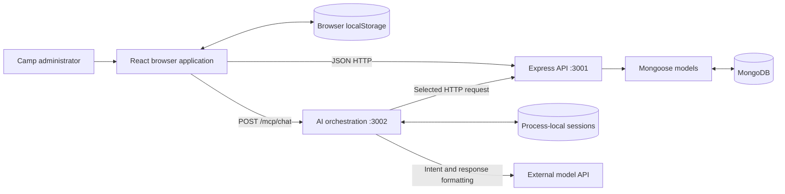
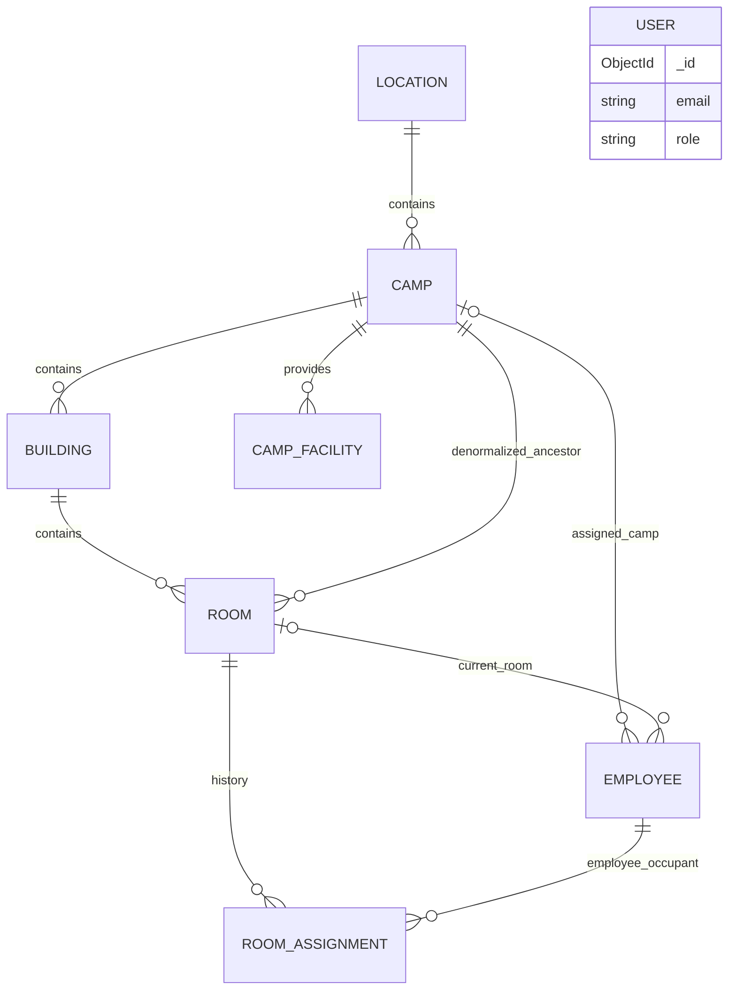

# CampWise technical architecture

**Reviewed:** 11 October 2026 · **Baseline:** `c8c7514` · [Documentation index](README.md)

## 1. Purpose and domain

CampWise is an accommodation administration application. Its hierarchy is **Location → Camp → Building → Room**. Staff create that structure, register employees and visitors, assign rooms, record checkout, and monitor accommodation status.

A location groups camps. Every camp requires a location. Rooms require a building, including when a camp consists of only one building. Floors are integer attributes and generated summaries, not independent entities. Facilities, such as a mosque or mess, belong directly to camps.

The assignment model allocates a whole room to one active assignment. `capacity` describes a room but does not enable bed-level allocation. Employees are accommodation occupants; `User` records are login accounts. These collections have no declared ownership relationship.

## 2. Implementation coverage

| Capability | Implementation | Persistence / boundary |
| --- | --- | --- |
| Sign-in/sign-up | JWT issuance, bcrypt passwords, frontend sessions | MongoDB users and persisted browser auth |
| Dashboard | Totals, occupancy, recent assignments, upcoming checkout, maintenance summaries | API data plus local maintenance records |
| Locations/camps/buildings | CRUD APIs, hierarchy checks, live counts, camp creation with buildings | MongoDB |
| Rooms | Create, update, delete, filter, bulk generate, assign | MongoDB; display categories are static |
| Employees/visitors | Create, edit, filter, inspect history, deactivate/end visit | Both use Employee records |
| Assignments | Check-in, list/filter, checkout, API cancellation | Assignment, room, and employee documents |
| Facilities | CRUD API, service, hook, seeded examples | MongoDB; no dedicated main page route |
| Maintenance requests | Validated form recording a summary | Browser localStorage only |
| Inventory | Overview/placeholder UI | No active stock/asset model or API |
| AI chat | Intent analysis, backend request, formatted reply | External model; process-local memory |
| Room categories | Static records; update returns a modified object | No persistence or main RoomCategories route |
| Password recovery/reset | Frontend forms and calls | No matching active backend endpoints |
| Role authorization | Fields and frontend guard infrastructure | Empty page authority requirements; backend auth is unmounted |

## 3. Runtime architecture

The browser does not need direct MongoDB access. Legacy frontend configuration nevertheless includes a credential-bearing URI fallback; remove it and review the credential before distribution. Its value is intentionally excluded here.

| Process | Source | Behavior |
| --- | --- | --- |
| Frontend | [package.json](../package.json), [vite.config.ts](../vite.config.ts), [main.tsx](../src/main.tsx) | React SPA; `@` aliases `src`; build output is `build/` with source maps |
| Backend | [server/package.json](../server/package.json), [server/server.js](../server/server.js) | Express API, Mongoose, `/health` |
| AI service | [mcp-server/package.json](../mcp-server/package.json), [server.js](../mcp-server/server.js) | HTTP `/mcp/chat` and `/mcp/health` |
| Legacy backend | [server/index.js](../server/index.js) | Different health path, automatic sample seed, different static path; not the package start target |

`mcp-server` means this repository's **Model Control Plane**. It does not use a Model Context Protocol SDK or expose a protocol tool server; its integration is ordinary HTTP.

### Declared stack

These are manifest versions, not claims about current releases.

| Area | Dependencies |
| --- | --- |
| Browser | React/React DOM `19.0.0`, React Router `6.26.2` |
| State/data | Redux Toolkit `^2.5.0`, React Redux `^9.2.0`, redux-persist `^6.0.0`, Axios `^1.7.7`, fetch |
| UI | Tailwind `^4.0.0`, Formik, Yup, TanStack Table, React Select, Framer Motion, React Icons |
| Build | Vite `^6.0.6`, TypeScript `^5.7.2`, Rollup TypeScript plugin |
| Backend package | Express `^4.18.2`, Mongoose `^8.0.0`, bcryptjs `^3.0.2`, jsonwebtoken `^9.0.2`, Helmet, Morgan, CORS |
| AI package | OpenAI SDK `^4.28.0`, Express `^4.18.2`, Axios, Helmet, Morgan |

The root also declares Express 5 and a different Mongoose range. Install each server package's own dependencies. The root package name remains `elstar`, reflecting the UI template origin.

### Repository map

| Path | Responsibility |
| --- | --- |
| `src/views/` | Pages and user interactions |
| `src/components/admin-dashboard/` | Shared hierarchy/employee forms and older admin components |
| `src/components/ui/` | Reusable UI primitives |
| `src/components/layouts/`, `template/`, `route/` | App shell, navigation, guards |
| `src/hooks/` | Domain fetching/mutations, local state, notifications |
| `src/services/` | HTTP clients, transformations, older generic data access |
| `src/store/` | Auth, locale, theme, base, room, RTK Query |
| `src/configs/`, `src/utils/` | Configuration and helpers, including local maintenance storage |
| `server/models/`, `routes/`, `validators/` | Schemas, HTTP handlers, hierarchy rules |
| `server/scripts/` | Development seed and migration |
| `mcp-server/` | AI routing, endpoint selection, memory |
| `tests/` | Dashboard helper and assignment-query tests |
| `public/`, `src/assets/` | Static resources and styles |
| `build/`, `output/` | Generated artifacts |

## 4. Frontend design

### Bootstrap and navigation

[App.tsx](../src/App.tsx) mounts Redux Provider → PersistGate → BrowserRouter → Theme → Layout, inside React StrictMode. Pages are lazy-loaded. The authenticated layout mounts [AskAIWidget](../src/components/shared/AskAIWidget/AskAIWidget.tsx).

| URL | Purpose |
| --- | --- |
| `/sign-in`, `/sign-up` | Login and registration |
| `/forgot-password`, `/reset-password` | Recovery forms; backend incomplete |
| `/home` | Dashboard |
| `/locations-camps` | Hierarchy overview and creation |
| `/rooms` | Room list, categories, creation/generation/assignment |
| `/room-assignments` | Assignment list/detail, check-in, checkout |
| `/employees` | Employee/visitor management |
| `/inventory-maintenance` | Inventory overview and local requests |

Template demo routes remain registered. RoomCategories and older dashboard components are not necessarily navigable merely because their files exist. See [route configuration](../src/configs/routes.config/routes.config.ts).

[ProtectedRoute](../src/components/route/ProtectedRoute.tsx) checks `token && signedIn`, redirecting to `/sign-in?redirectUrl=<pathname>`. It preserves the pathname, not query parameters, and does not validate token expiry. Active protected pages use `authority: []`.

### State and networking

| Layer | Behavior |
| --- | --- |
| Redux | Auth/session, user, locale, theme, base, room, RTK Query |
| redux-persist | Persists auth and locale at localStorage key `admin`; other slices are not whitelisted |
| Domain hooks | Fetch on mount/dependency change; track loading/error/pagination; mutate local data and notify |
| [api.ts](../src/services/api.ts) | Axios at backend origin, helper paths include `/api`; no auth interceptor |
| [BaseService](../src/services/BaseService.ts) | Axios at `<origin>/api`, 60-second timeout, Redux bearer token, clears signed-in state on 401 |
| Employee/assignment services | Additional fetch wrappers reading `localStorage.token`; some pages use hooks/API helpers instead |
| [RoomService](../src/services/RoomService.ts) | Converts room documents into page objects and back |
| [MongoService](../src/services/MongoService.ts) | Generic abstraction whose expected envelope/filter semantics differ from dedicated routes |

There is no unified token source or error contract. Authentication persists the Redux `admin` object, while fetch/AI helpers read `token` or `authToken` directly.

RoomService transforms `_id` → `id`, `camp` → `campId`, populated building → ID plus `buildingName`, and `price` → `pricePerNight`. Its writes omit camp because the server derives it. `getRooms()` catches errors and returns `[]`; the raw `useRooms` hook records an error. Different screens can therefore show empty data versus an error for the same outage.

### Browser persistence

| Key | Data |
| --- | --- |
| `admin` | Redux auth and locale |
| `mcp_session_id` | AI session ID; server history may expire independently |
| `campwise_maintenance_requests_v1` | Maintenance summaries; browser origin/profile only |

Maintenance stores `id`, `createdAt`, `itemName`, `requestKind`, `priority`, `areaType`, optional `campId`, `roomId`, and `locationNote`. The form collects description and contact phone but does not persist them. No request status, assignee, completion, stock deduction, or room-status change is implemented.

## 5. Data model

Source: [models](../server/models/). ObjectId references are application relationships, not database foreign keys.

| Mongoose model | MongoDB collection | API resource |
| --- | --- | --- |
| Location | locations | /api/locations |
| Camp | camps | /api/camps |
| Building | buildings | /api/buildings |
| Room | rooms | /api/rooms |
| CampFacility | campfacilities | /api/facilities |
| Employee | employees | /api/employees |
| RoomAssignment | roomassignments | /api/assignments |
| User | users | /api/users |

Collection names above were checked from the loaded model definitions without connecting to a database. In particular, API resource names `facilities` and `assignments` are aliases; their physical collections have different names. Keep that distinction when inspecting or migrating data.

The employee-assignment edge applies logically to `occupantType = Employee`; `occupantId` has no Mongoose ref. Temporary visitors are neither populated nor existence-checked by that handler. The diagram does not imply uniqueness of employee room pointers.

### Location

| Field | Type / constraint |
| --- | --- |
| `name` | Required trimmed string, unique index |
| `city`, `address`, `description` | Optional trimmed strings |
| `image` | String, default empty |
| `coordinates.lat`, `coordinates.lng` | Optional numbers; no range validators |
| `status` | `active` / `inactive`, default active |
| `createdAt`, `updatedAt` | Automatic timestamps |

Indexes: unique name, city, status. Creation uses a case-insensitive duplicate pre-check, but the unique index has no case-insensitive collation. Reads compute `campCount` and `roomCount`.

### Camp

Required name and `locationId` reference a location. `location` is a deprecated denormalized string. Other fields: description, price ≥ 0 (default 0), image, rating 0–5 (default 0), status (`active`, `inactive`, `maintenance`), created/updated dates. The dedicated PATCH updates modification time.

Indexes: unique `(locationId, name)` and status. Read-time values: `buildingCount`, `totalRooms`, `availableRooms`, `occupiedRooms`, `maintenanceRooms`, `cleaningRooms`. These counters are not stored.

### Building

Required `campId` and trimmed name. Type: `residential`, `admin`, `medical`, `storage`, `other` (default residential). Floors: number ≥ 1, default 1; routes additionally require an integer. Optional description, status active/inactive/maintenance, automatic timestamps.

Indexes: campId, `(campId, status)`, unique `(campId, name)`. Reads compute roomCount, availableRooms, occupiedRooms. Dedicated PATCH cannot change campId.

### Room

| Field | Type / constraint | Meaning |
| --- | --- | --- |
| `camp` | Required Camp ObjectId | Ancestor derived from building on dedicated writes |
| `buildingId` | Required Building ObjectId | Placement parent |
| `floor` | Number ≥ 1, default 1 | Routes enforce integer and building bounds |
| `roomNumber` | Required trimmed string | Unique within building across floors |
| `type` | single/double/suite/family | Required enum |
| `capacity` | Required number ≥ 1 | Room metadata, not bed allocation |
| `price` | Number ≥ 0, default 0 | No currency field |
| `amenities`, `images` | String arrays | Inline metadata/references |
| `status` | available/occupied/maintenance/cleaning | Default available |
| `description` | Optional string | Details |
| `createdAt`, `updatedAt` | Explicit dates | Dedicated PATCH updates modification date |
| `isAvailable` | Read-only virtual | True only for available status |

Indexes: camp, buildingId, `(buildingId, floor)`, status, unique `(buildingId, roomNumber)`. Virtuals are enabled for model serialization, but generic lean reads may omit them. PATCH accepts the legacy boolean only when status is absent.

### CampFacility

Required campId, kind, and trimmed name. Kinds: mosque, mess, playing_area, recreation_center, medical, laundry, parking, other. Capacity ≥ 0 defaults to 0; optional description/openingHours; status active/inactive/maintenance; automatic timestamps. Indexes: campId, `(campId, kind)`, status. Creation checks camp existence; dedicated PATCH cannot move the facility.

### Employee

Required: firstName, lastName, email, phone, iqamaNumber, employeeId. Email is trimmed/lowercased. Email, iqamaNumber, and employeeId each have a unique index.

Optional: location (free text), project, department, designation, campId, currentRoomId (default null). Employee type is `Permanent`, `Temporary`, or `Visitor` (default Permanent). Status is **`Active` / `Inactive`**, with uppercase initials.

Embedded `roomAssignmentHistory` contains `{roomId, startDate, endDate}`; dates default to now/null. Automatic timestamps; additional indexes on campId, employeeType, status, location. Employee CRUD can update embedded history independently of RoomAssignment documents.

### RoomAssignment

Required roomId, occupantId ObjectId, occupantType (`Employee` / `Temporary Visitor`), startDate, expectedCheckoutDate. The route requires dates explicitly even though the schema defaults startDate. checkInTime defaults to now; checkOutTime defaults null. Status: active/completed/cancelled; default active. Automatic timestamps.

Indexes: roomId, occupantId, status, startDate, `(roomId, status)`. There is no unique active-assignment index. The route checks before insert, allowing concurrency races. No server-side occupant uniqueness or checkout-after-start rule exists.

### User

Required name, unique lowercased email, password of minimum length 6. Roles user/admin; schema default user. The save hook hashes modified passwords using bcrypt cost 10, and sign-in compares hashes. Automatic timestamps.

Sign-up explicitly assigns admin to every registration. Generic query updates do not run the password save hook and are not a safe account-edit workflow.

## 6. Backend request design and consistency

Middleware order: Helmet → CORS → Morgan → JSON (10 MB) / URL-encoded parsing → API logging → dedicated routers → auth endpoints → generic CRUD → health/404/error handling.

[hierarchy.js](../server/validators/hierarchy.js) maps custom HTTP errors, duplicate indexes (409), validation (400), and cast errors (400) to `{message}`. Other handlers sometimes return `{error}` or different codes.

| Rule | Enforcement | Limit |
| --- | --- | --- |
| Camp location exists | Dedicated camp POST/PATCH | Generic PUT bypasses helper |
| Room building/floor valid | Dedicated room POST/placement PATCH/bulk | Generic PUT bypasses placement checks |
| Room camp matches building | Derived by dedicated writes | No cross-document DB constraint |
| Floor shrink preserves existing rooms | Building PATCH checks higher floors | Generic PUT bypasses check |
| Parent delete respects children | Location checks camps; camp checks rooms/buildings; building checks rooms | Camp ignores facilities/employees; room ignores assignments/employees |
| Camp and inline buildings coordinated | Transaction with standalone compensation | Compensation deletes camp only; partially created buildings may remain |
| Bulk room duplicates rejected | Preflight plus unique index | No transaction; concurrent insertion failure can partially write |
| Assignment updates related data | Sequential employee/assignment/room saves | No rollback or transaction |

Generic routes follow dedicated routers and remain reachable for unhandled methods. Not all writes pass through hierarchy helpers. See [compatibility routes](API_REFERENCE.md#10-generic-and-legacy-routes).

## 7. Authentication and authorization

Sign-in uses **name** via `{user, password}`, not email. Sign-up accepts `{name, email, password}`. Tokens contain userId and expire after 24 hours. JWT_SECRET has a hardcoded fallback.

The backend `auth` middleware verifies a bearer token and loads the user but is never mounted. The users route comment “admin only” has no corresponding role check. Frontend route visibility is not a backend authorization boundary.

Sign-out clears browser state despite API failure; no active backend sign-out or revocation endpoint exists. Password reset/recovery routes are also absent.

## 8. AI integration

Sources: [chat router](../mcp-server/routes/chat.js), [AI service](../mcp-server/services/aiService.js), [API discovery](../mcp-server/services/apiDiscovery.js), [memory](../mcp-server/services/conversationMemory.js).

1. Browser sends message/session ID/optional token to `/mcp/chat`, with a 30-second timeout.
2. Text cleanup removes some script-like text and truncates to 2,000 characters. This does not establish authorization or prevent prompt injection.
3. Session history is loaded and the new user message saved in a Map.
4. Model returns JSON intent, confidence, endpoint, method, parameters. The configured default model string is `gpt-4o-mini`; analysis uses temperature 0.3 and 1,000 output tokens.
5. Unknown or confidence < 0.5 returns clarification. General query returns fixed help text.
6. Endpoint validation checks only the extracted collection against a catalogue, not the path/method matrix.
7. Axios calls the backend with optional bearer token. A second model call formats the result, temperature 0.7 and 500 output tokens; formatting failure uses deterministic text.
8. Reply is saved in memory and returned with session/timing metadata.

Discovery probes `/health` and caches a hardcoded catalogue for five minutes. It knows camps, rooms, employees, users, assignments, but not locations/buildings/facilities. Prompted writes focus on employees, while collection-only validation permits a broader surface.

Memory retains 20 messages by default; getHistory returns at most 10 and intent analysis uses the last 5. Idle timeout is one hour with cleanup every ten minutes. Restarts lose history; replicas do not share sessions. Session endpoints lack user ownership checks. Client clearSession removes only the local ID.

Backend data, including requested employee details, is sent to the model formatter without a redaction layer. Widget connection/timeout failures can trigger keyword-based simulated replies, which do not demonstrate successful backend access.

## 9. Known limitations and engineering priorities

These findings describe existing code; documentation work does not implement the proposed fixes.

| Priority | Finding | Consequence / follow-up |
| --- | --- | --- |
| High | Auth unmounted, every signup admin, fallback JWT secret | Enforce identity and role policy before deployment |
| High | Credential-bearing frontend DB fallback | Remove client DB config and review/rotate credential |
| High | Generic writes bypass dedicated rules | Consolidate handlers/allowlists; preserve hashing and hierarchy rules |
| High | Assignment writes nontransactional; no unique active index | Partial writes and double assignment possible |
| High | Checkout compares employee room ID with populated `assignment.roomId.toString()` | Employee cleanup may be skipped; normalize both IDs and test |
| High | Temporary Visitor branch omits employee validation/history updates | Visitor and accommodation state can diverge |
| High | Employee room edit/end visit/deactivation does not reconcile assignments | Centralize allocation changes |
| High | AI validation is collection-only; sessions unauthenticated | Validate method/path/body and session ownership |
| Medium | Some deletion dependents unchecked | Orphaned references possible |
| Medium | Bulk lacks transaction; camp fallback incomplete | Full atomicity is not guaranteed |
| Medium | Maintenance local-only and omits description/contact | Backend required for real ticket tracking |
| Medium | Undefined `createGenericSchema()` | Generic count/deleteMany/aggregate fail when reached |
| Medium | Multiple clients, token sources, room types | Standardize contracts and error handling |
| Medium | Unpaginated hierarchy lists and per-assignment employee reads | Scaling costs increase with data volume |
| Medium | Some screen options/search derive only from loaded data | Current-page results may not reflect the whole database |
| Medium | `mockEnabled` config is read as `enableMock` | Mock enablement mismatch |
| Medium | Vite references Babel/Emotion plugins absent from root direct dependencies | Clean-build reproducibility needs verification |
| Medium | Logs include employee payloads and AI message snippets | Review personal-data logging |
| Low | Legacy entry point, demo pages, unused service families | Clarify supported surface and retire obsolete code |

## 10. Test and deployment boundaries

[dashboard.test.cjs](../tests/dashboard.test.cjs) covers occupancy, date windows/formatting, and assignment-list queries with mocked models. It does not exercise real MongoDB, browser journeys, authentication, or AI calls.

There is no root npm test script, committed deployment pipeline, or container definition in the reviewed source. The normal backend does not serve the Vite build. [Operations](OPERATIONS.md) contains exact commands and verification limits.
